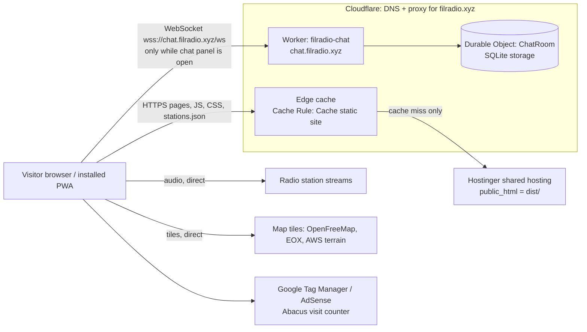
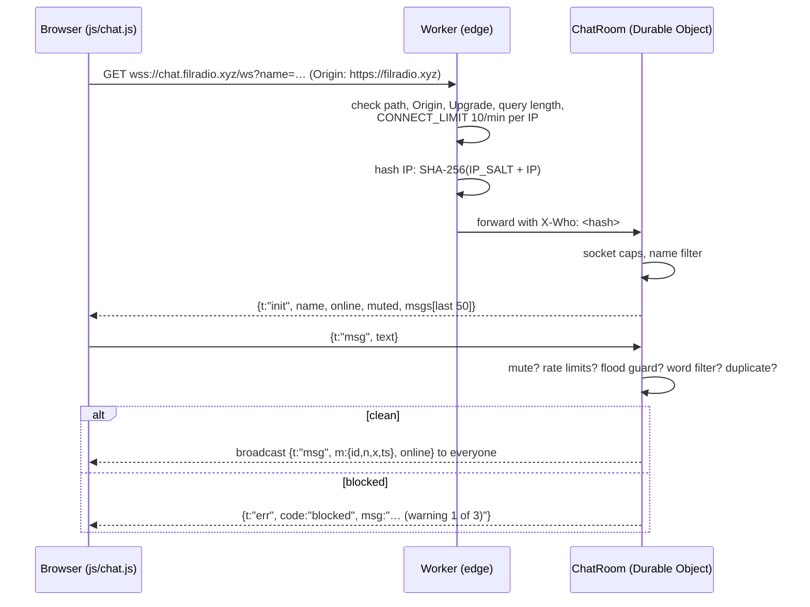

# FilRadio

Listen to Philippine FM, AM and online radio on a 3D map, at home or abroad. Tap a pin and it plays live.
Includes a moderated global listener chat.

**Live:** https://filradio.xyz/


---

## Contents

1. [Architecture at a glance](#architecture-at-a-glance)
2. [Hosting and infrastructure](#hosting-and-infrastructure)
3. [Website (static PWA)](#website-static-pwa)
4. [Global chat](#global-chat)
5. [Security and abuse protection](#security-and-abuse-protection)
6. [Privacy](#privacy)
7. [Run locally](#run-locally)
8. [Deploy checklist](#deploy-checklist)
9. [Moderation](#moderation)
10. [Troubleshooting](#troubleshooting)
11. [Repository structure](#repository-structure)

---

## Architecture at a glance



| Piece | Where it runs | What it does |
| --- | --- | --- |
| Website | Hostinger (static files from `dist/`) behind Cloudflare | Map, station list, player, PWA. No server code, no database. |
| Edge cache | Cloudflare | Serves almost every page/file so Hostinger is rarely hit. |
| Chat server | Cloudflare Worker + one Durable Object (`chat-worker/`) | Real-time chat, rate limits, word filter, strikes, mutes, reports. Never touches Hostinger. |
| Station data | `data/stations.json`, generated offline by `tools/update_stations.py` | Visitors never call the upstream directory. |
| Audio | Station servers, directly from the browser | FilRadio never proxies audio. |

---

## Hosting and infrastructure

### Domain and DNS

- Domain `filradio.xyz` uses **Cloudflare nameservers**. Cloudflare proxies the site (orange cloud).
- `chat.filradio.xyz` is a **Workers custom domain**, created automatically by `wrangler deploy` (see `chat-worker/wrangler.toml`).
- The Worker has **no `workers.dev` URL and no preview URLs** (`workers_dev = false`, `preview_urls = false`), so the chat is reachable at one address only.

### Hostinger

- Plain static hosting. The **contents** of `dist/` go into `public_html` over FTP or hPanel File Manager.
- **Cloudflare DNS records** (only these): A `filradio.xyz` → `195.35.62.140` (Hostinger website IP, Proxied), CNAME `www` → `filradio.xyz` (Proxied), Worker `chat` → `filradio-chat`, A `ftp` (unused by FTP clients; upload using the IP). No AAAA records and nothing pointing to `cdn.hstgr.net`.
- Hostinger shows "Domain isn't connected" because the nameservers are Cloudflare's. That is expected; never switch the nameservers back.
- **Hostinger CDN is off.** It can't run while the domain uses Cloudflare nameservers, and stacking both caused HTTP 429.
- Hostinger's edge (responses carry `platform: hostinger` and `x-hcdn-request-id`) rate-limits traffic. When too many requests arrive through Cloudflare it answers **429** for everything. The Cloudflare cache rule below is what keeps this from happening.

### Cloudflare cache rule (required)

Cloudflare → filradio.xyz → **Caching → Cache Rules** → rule **"Cache static site"**:

| Setting | Value |
| --- | --- |
| Expression | `(http.host eq "filradio.xyz")` (Hostname equals, not "URI Full") |
| Cache eligibility | Eligible for cache |
| Edge TTL | Ignore cache-control header, use **2 hours** |
| Status code TTL | 400 to 599: no cache (never cache Hostinger 429/5xx pages) |
| Browser TTL | Respect origin |

The rule does not match `chat.filradio.xyz`, so the chat is never cached.

Check it works: `curl -sI https://filradio.xyz/ | grep -i cf-cache-status` should say `HIT` (or `MISS` on the first request), never `DYNAMIC`.

**Because of this rule you must purge Cloudflare after every upload** (Caching → Configuration → Purge Everything), or visitors keep the previous version for up to 2 hours.

### Recommended extra Cloudflare settings (free)

- Cache rule → **Cache key → Query string: Ignore**, so `?x=random` requests can't bypass the cache.
- **Security → WAF → Rate limiting rule**: Hostname equals `filradio.xyz`, 60 requests / 10 s per IP, Block 1 minute.
- **Security → Bots → Bot Fight Mode**: On.

### Cost

- Hostinger: existing plan, load reduced to cache misses.
- Cloudflare: **Workers Free plan**. If the daily free quota is ever exhausted, the chat pauses until it resets. Nothing is billed. Keep the account on the free plan to keep this guarantee.

---

## Website (static PWA)

### Features

- **Map that starts in fast 2D**; tap 3D for terrain, globe and buildings (loaded only on demand, choice remembered). Station clusters are drawn as the FilRadio sun
- **600+ stations**, merged and de-duplicated, with backup streams
- **Location search**: type a city or province (Cebu, Davao, Bohol…) to list stations within 45 km, nearest first; or tap *near me*
- **For OFWs**: streams work from any country; visitors abroad get a welcome note
- **Views**: phones get Map, List, Radio, Grid and Playing tabs in a floating dock; desktop has a Map | Grid switch
- **Filters**: "Plays here", "On air", "Favorites", "Unknown city", explained behind an (i) button
- **Favorites** saved on the device
- **Dark mode**
- **Mobile app layout**: floating search, bottom sheet, full-screen Now Playing with a tuning dial
- **Sleep timer**: moon button on the mini player (and "Sleep timer" on the phone's Now Playing screen). Each tap cycles Off, 15, 30, 60, 90 minutes; the button shows minutes left; at the end the sound fades out over 10 s and stops. Browser only.
- **Continue listening**: the last station that actually played is remembered on the device (`filradio.last`); on the next visit a "Continue listening" card offers it with one tap (hidden after 20 s, or when anything plays). Browser only.
- **Lock-screen and car controls** via the Media Session API (audio works over CarPlay / Android Auto)
- **Installable PWA** with an illustrated install guide for desktop, Android and iPhone/iPad
- **Works offline** for the app itself and the last station list
- **Global listener chat** (floating bubble, bottom right). See [Global chat](#global-chat)
- **SEO**: meta tags, Open Graph / Twitter cards, JSON-LD, image sitemap, robots.txt
- **Ads and analytics**: Google AdSense (Auto ads) and GTM, both skipped on localhost; `ads.txt`; `privacy.html`
- **Visitor counter** and anonymous traffic-source report at `/stats.html` (Abacus counters, one count per device per day)

### How the page is put together

- No framework and no bundler. Each feature is a plain IIFE script loaded with `defer`:
  `places.js`, `traffic.js`, `install-guide.js`, `app.js`, `chat.js`. `theme.js` and `gtm.js` load early in `<head>`.
- **Icons** are one inline SVG sprite in `index.html` (`<symbol id="i-…">`), used with `<use href="#i-…">`.
- **Design tokens** are CSS variables on `:root` in `css/style.css`; dark mode overrides them on `html.dark`.
- **Layouts**: desktop/tablet uses `@media (min-width: 761px), (min-width: 481px) and (max-height: 500px)`;
  phones use `@media (max-width: 760px) and (min-height: 501px), (max-width: 480px)`.
- **Content-Security-Policy** is a `<meta>` tag in `index.html`. `connect-src` allows `wss://chat.filradio.xyz` (and `ws://localhost:8787` for development).

### Service worker and cache busting

- `sw.js` caches the app shell (network first, cache as offline fallback) and versioned CDN libraries (cache first). Streams, tiles and APIs are never cached.
- **On every release** bump the version everywhere:
  - `?v=N` on every asset in `index.html`, `stats.html`, `privacy.html` and in the `SHELL` list in `sw.js`
  - `VERSION = "filradio-vN"` in `sw.js`

  Current version: **73**.

### Station data

- `tools/update_stations.py` downloads Philippine stations from the public radio directory, merges duplicates, pins them to cities (`js/places.js` gazetteer), and checks each stream once to mark which are on air.
- Output: `data/stations.json`. The app only ever reads this file from its own domain.
- Stations with no city in the directory are matched against `window.PH_STATION_HOMES` in `js/places.js` (call signs like DZMM, DZRH, DWTM and brands like Magic 89.9, Barangay LS, MOR), so big Mega Manila stations get pinned to Metro Manila / Quezon City instead of "Unknown city". It is used only when the gazetteer finds no place, so "Love Radio Cebu" still goes to Cebu. Add new patterns there when listeners report a missing station.
- The default list shows every station, including those with no known city (grey pins near Manila, "Location unknown"). The **Unknown city** filter narrows the list to only those stations.
- In the browser the list is cached for 6 hours per device; after a failed fetch the app waits 60 s before retrying.

### SEO

- `<title>` (about 60 chars) and meta description (about 150 chars, under Google's cut-off), canonical URL, `robots` with large image previews, Google site verification.
- Open Graph and Twitter card with `og-image.png` (1200x630).
- JSON-LD `@graph`: `WebSite` (site name and alternate names), `WebApplication` (description, free offer, feature list) and `Person` (author), linked by `@id`.
- **Crawlable station names**: `tools/build.py` writes the 40 most-voted playable stations into the "About FilRadio" box of `dist/index.html` (`#popularStations`), so searches like "DZRH live" have real text to match. The source `index.html` keeps the paragraph empty (hidden with CSS).
- `sitemap.xml` (home page with image, privacy page); the build stamps the home page `<lastmod>` with the build date. `robots.txt` points to it. `stats.html` is `noindex`.
- `<noscript>` text describes the site for crawlers without JavaScript.
- After a release with new content, resubmit the sitemap in Google Search Console if needed.

### Content rules

- No em dashes in any visible text, titles or meta tags (use a colon, pipe or comma).

---

## Global chat

Source: `chat-worker/` (server) and `js/chat.js` (client). One global room.

### Look and usage

- A yellow **Chat** pill at the bottom right (bounces twice a few seconds after load so people notice it) opens the chat panel. The panel is dark in both themes, like the radio display: plain header with the online count, a one-line rules note, messages with coloured names and small monospace times, and a yellow edge on your own messages. Open, the pill becomes a round close button.
- **Changing your name**: tap your name or the **Change name** button under the messages, type a new name, then **Save** (Enter) or **Cancel** (Esc). First-time chatters get a one-time tip explaining this, and the SYS rules line mentions it too. Names are 2 to 20 letters or numbers and go through the word filter. The name is remembered on the device (`localStorage` keys `filradio-chat-name` and `filradio-chat-name-set`).
- First-time visitors see a one-time hint above the pill ("Chat with other listeners here") for 9 s; never again on that device (`filradio-chat-hint`). The chat is never opened automatically (it would cover the screen on phones and connect every visitor).
- Report: hover a message (always visible on touch screens) and tap the flag.
- **Typing indicator** above the name row: "Ana is typing…", "Ana and Ben are typing…", "3 people are typing…". Hidden after about 5 s without news or when that person's message arrives.
- **Order**: oldest at the top, newest at the bottom, in the order the server received them (server timestamps). If you have scrolled up, new messages don't pull you down; a **New messages** button appears instead.
- **Grouping**: messages from the same person within 2 minutes show the name only once.
- **Listening to**: if you are playing a station when you send, its name shows next to yours (from the mini player). It goes through the word filter and is dropped if it breaks a rule.
- **No look-alike names**: a name used by someone else right now (or in the visible history) can't be taken; on connect, digits are added (`maria117`).
- A character counter appears when 40 or fewer characters are left.
- **Country flag** next to names, from Cloudflare's `request.cf.country` (2 letters only, nothing else about the visitor). Shown as a real flag image from the open-source [flag-icons](https://github.com/lipis/flag-icons) set (`cdn.jsdelivr.net/npm/flag-icons@7.2.3`, about 1 KB SVG each, loaded lazily and cached by the browser and service worker); a 2-letter badge is the fallback. Hover shows the country name. Each person can turn it off under **Change name** ("Show my country flag", saved in `localStorage` key `filradio-chat-flag`, sent as `?flag=0` / `{t:"flag", on}`).
- **Pabati (shout-out)**: the megaphone button in the message bar sends the next message as a highlighted "Pabati" card. Limited to 1 per person every 10 minutes (stored in the person's `u:<hash>` record as `g`).

### Why this design

- The website is static and Hostinger is easily rate-limited, so the chat **runs entirely on Cloudflare**.
- **Durable Object with WebSocket Hibernation**: one object holds the room. Idle connections cost nothing; the object sleeps between messages.
- Keep-alive `ping` frames are answered by Cloudflare automatically (`setWebSocketAutoResponse`) without waking the room.
- The client **connects only while the chat panel is open** and disconnects 60 s after it is closed or the tab is hidden. Visitors who never open chat create zero chat traffic.

### Flow



### Message protocol (JSON over WebSocket)

| Direction | Message | Meaning |
| --- | --- | --- |
| client → server | `{t:"msg", text, st?, g?}` | Send a message; `st` = station being played (optional, max 40 chars, filtered); `g:1` = pabati |
| client → server | `{t:"flag", on}` | Show or hide your country flag on new messages |
| client → server | `{t:"report", id}` | Report a message |
| client → server | `{t:"name", name}` | Change display name |
| client → server | `{t:"typing"}` | "Is typing" (client sends at most every 4 s; server relays at most every 3 s, never stores it) |
| client → server | `ping` (plain text) | Keep-alive, auto-answered `pong` |
| server → client | `{t:"init", name, online, muted, msgs}` | Sent on connect |
| server → client | `{t:"msg", m:{id,n,x,ts,s?,c?,g?}, online}` | New message (`s` = station tag, `c` = country code, `g` = pabati) |
| server → client | `{t:"typing", n}` | Someone else is typing |
| server → client | `{t:"online", n}` | Online count after joins/leaves (at most once every 10 s for the whole room, only when it changed; a change inside the window is sent when it ends) |
| server → client | `{t:"del", id}` / `{t:"clear"}` | Message removed / room cleared |
| server → client | `{t:"err", code, msg, until}` | `slow`, `busy`, `blocked`, `dupe`, `muted`, `name`, `pabati` |
| server → client | `{t:"reported", id}` / `{t:"name", name}` | Acknowledgements |

Other users only ever receive `id`, `n` (name), `x` (text) and `ts`. The IP hash and report list never leave the server.

### Limits (`LIMITS` in `chat-worker/src/index.js`)

| Limit | Value |
| --- | --- |
| Message length | 200 characters (frames over 1000 bytes close the socket) |
| Name length | 2 to 20 letters/numbers |
| Per person | 1 message every 4 s, 8 per minute, no exact repeats |
| Online count push | on join/leave only, max once per 10 s per room, never stored; skipped changes are sent by one follow-up alarm (max 6 a minute, only during join/leave bursts) |
| Typing signal | relayed at most once every 3 s per person; muted people are never shown |
| Whole room | 40 messages per 10 s |
| Any frames (junk included) | 20 per 10 s, else socket dropped + strike |
| Connections | 2 tabs per person (oldest is closed), 400 in the room |
| Connects at the edge | 10 per minute per IP (`CONNECT_LIMIT` binding) |
| Admin attempts | 5 per minute per IP (`ADMIN_LIMIT` binding) |
| History | Last 50 messages, deleted after 6 hours |

### Word filter (`chat-worker/src/filter.js`)

- Lists: **English, Tagalog and Bisaya** swearing, sexual words, slurs, threats and solicitation phrases.
  - `SUBSTR`: matched inside words (`fucking`, `putanginamo`)
  - `EXACT`: whole words only, for words that hide inside innocent words (`ass`/class, `rape`/grape, `tite`/appetite)
  - `PHRASES`: multi-word (`tang ina`, `send nudes`, `kill yourself`, `dm me`)
  - Extra words added live by the admin endpoint (stored in the Durable Object)
- Normalisation before matching: Unicode NFKC/NFKD, accents and zalgo removed, zero-width characters removed, leetspeak (`0→o 1→i 3→e 4→a 5→s 7→t @→a $→s`), Cyrillic/Greek look-alikes, separators inside words (`f.u.c.k`, `f*ck`), spaced letters (`p u t a`), repeated letters (`fuuuck`), and a no-spaces check for long unmistakable words.
- Also blocked: **links** (any `http`, `www.`, `something.com/.ph/.xyz…`, "dot com"), **emails**, **phone numbers** (7+ digits, `09xx`, `+63`), **@handles**.
- ALL-CAPS messages are toned down, and long repeated characters are shortened.
- Names go through the same filter; a bad name becomes `Listener1234` (and a strike when changed to one).
- Known innocent words that pass: petition, therapist, leche flan, ilagay, bilateral, appetite, competitive, Sussex, grapes, analysis, "mata ng ina".

### Strikes, mutes and automatic removal

- Each blocked message = 1 warning ("warning 1 of 3").
- **3 warnings within 1 hour → muted**: 30 minutes, then 24 hours, then 7 days for repeat offenders. All their messages are removed for everyone when muted.
- **Reports**: 3 different people reporting a message removes it and gives the sender a warning. Max 10 reports per person per hour; you can't report yourself.
- Records are kept per **hashed IP**, and a daily alarm forgets people 30 days after their last mute.

### Durable Object storage

| Key | Content |
| --- | --- |
| `msgs` | Array of the last 50 messages: `{id, n, x, ts, h, rep[]}` (`h` = IP hash) |
| `u:<hash>` | `{strikes[], mutes, until, g}` per person (`g` = time of last pabati) |
| `words` | Extra blocked words added by the admin |
| `cleanAt` | When the next daily clean-up runs (the single alarm also sends follow-up online counts) |

### Secrets (Cloudflare, never in git)

| Name | Purpose |
| --- | --- |
| `IP_SALT` | Salt for hashing IPs |
| `ADMIN_TOKEN` | Moderation password (24+ characters) |

A local copy lives in `chat-worker/.dev.vars` (git-ignored, also used by `wrangler dev`). Upload with `npx wrangler secret bulk .dev.vars`.

---

## Security and abuse protection

**Website**
- Static files only: no server code, forms, logins or database to attack.
- Content-Security-Policy, no inline event handlers, all station text escaped, only http(s) links allowed.
- Cloudflare cache in front; Hostinger only sees cache misses. Recommended WAF rate limit and Bot Fight Mode above.
- Station list cached 6 h per device; retries back off; directory "click" votes at most once per station per device per day; one stream connection at a time; next/previous throttled.

**Chat**
- Origin allowlist (`ORIGINS` in `chat-worker/src/index.js`): `https://filradio.xyz`, `https://www.filradio.xyz`, and localhost ports 5173/5500 for development.
- Everything that can be rejected is rejected **at the edge before the room wakes up**: wrong path or method (404), wrong Origin (403), not a WebSocket (426), long query (414), too many connects (429).
- Malformed JSON, non-object frames, wrong types or oversized frames close the socket.
- Admin endpoint: POST only, timing-safe token comparison, token must be 24+ characters, body max 2 KB, rate-limited.
- Messages are rendered with `textContent` only (no HTML injection); message ids are server-generated.
- Server-side everything: editing the page cannot bypass any limit or filter.

---

## Privacy

- See `privacy.html`. No accounts; location ("near me") stays on the device.
- Chat: messages and names are public and auto-deleted after 6 hours. Only a salted hash of the IP is stored (never the IP) for rate limits and mutes, forgotten 30 days after the last warning. The chosen name is kept in `localStorage` (`filradio-chat-name`).

---

## Run locally

Website (static, no build step):

```sh
python -m http.server 5173     # or VS Code Live Server on port 5500
# open http://localhost:5173
```

Chat server (optional, for testing chat locally):

```sh
cd chat-worker
npm install
npx wrangler dev --port 8787
```

On `localhost`/`127.0.0.1` the page connects to `ws://localhost:8787/ws` automatically; in production it uses `wss://chat.filradio.xyz/ws`.

---

## Deploy checklist

### Website (every release)

```sh
python tools/update_stations.py   # optional: refresh data/stations.json (daily keeps "On air" fresh)
# bump ?v=N and filradio-vN (see "Service worker and cache busting")
python tools/build.py             # minified dist/ + ../filradio-xyz-upload.zip
```

1. Upload the **contents** of `dist/` to `public_html` (FTP or hPanel). Upload only `dist/`; never `chat-worker/`, `tools/` or `.dev.vars`.
2. Cloudflare → **Purge Everything**.
3. Check: `curl -sI https://filradio.xyz/` returns `200`.

### Chat server (only when `chat-worker/` changes)

```sh
cd chat-worker
npx wrangler login                 # first time on a machine
npx wrangler secret bulk .dev.vars # first time, or when rotating secrets
npx wrangler deploy
```

First deploy on a new Cloudflare account: open **Workers & Pages** in the dashboard once so the account gets its workers.dev subdomain (Cloudflare requires it even though this Worker doesn't use it).

---

## Moderation

```sh
T="<ADMIN_TOKEN from chat-worker/.dev.vars>"
A="https://chat.filradio.xyz/admin"
curl -X POST $A -H "Authorization: Bearer $T" -d '{"action":"list"}'                           # messages + report counts
curl -X POST $A -H "Authorization: Bearer $T" -d '{"action":"del","id":"MSG_ID"}'              # delete one message
curl -X POST $A -H "Authorization: Bearer $T" -d '{"action":"ban","id":"MSG_ID","hours":168}'  # mute sender, remove their messages
curl -X POST $A -H "Authorization: Bearer $T" -d '{"action":"addword","word":"newword"}'       # block a word immediately
curl -X POST $A -H "Authorization: Bearer $T" -d '{"action":"delword","word":"newword"}'
curl -X POST $A -H "Authorization: Bearer $T" -d '{"action":"clear"}'                          # wipe the chat
```

Permanent changes to limits or word lists: edit `chat-worker/src/index.js` / `filter.js`, then `npx wrangler deploy`.

---

## Troubleshooting

| Symptom | Cause | Fix |
| --- | --- | --- |
| Site shows Hostinger **"Parked Domain"** page, or **429** / **525**, header `x-hcdn-request-id` | Cloudflare DNS still points at **Hostinger CDN** addresses (extra A/AAAA records, or `www` CNAME to `*.cdn.hstgr.net`) | Cloudflare DNS must have only: A `@` → website IP from hPanel (Websites → Dashboard → Website IP, currently `195.35.62.140`), CNAME `www` → `filradio.xyz`, Worker `chat`. Delete every other A/AAAA for `@` and anything pointing to `cdn.hstgr.net`. Purge Everything. |
| Site returns **429**, header `x-hcdn-request-id` (and DNS is correct) | Hostinger edge rate limit; Cloudflare not caching | Check the cache rule expression is `(http.host eq "filradio.xyz")`; purge; `cf-cache-status` must not be `DYNAMIC`. If it persists, ask Hostinger support to lift the limit / allow Cloudflare IPs. |
| Old version still showing after upload | Cloudflare cache (2 h) or service worker | Purge Everything; make sure `?v=N` and `filradio-vN` were bumped. |
| Chat says "Chat is offline" | Worker not deployed or blocked by CSP | `curl https://chat.filradio.xyz/` should return 404 (Worker alive). Check `connect-src` in `index.html` includes `wss://chat.filradio.xyz`. |
| Chat 403 from a new domain or port | Origin not in `ORIGINS` | Add it in `chat-worker/src/index.js`, redeploy. |
| `wrangler deploy` error 10063 "need a workers.dev subdomain" | New Cloudflare account | Open Workers & Pages in the dashboard once, retry. |
| Chat "Opened in another tab" | Same person opened a 3rd tab | Expected (2 tabs max). |
| An innocent word is blocked | Filter false positive | Move the word from `SUBSTR` to `EXACT`, or add it to `NO_SQUASH`, in `filter.js`; redeploy. |

---

## Repository structure

```
filradio/
├── index.html              Page, SEO tags, CSP, SVG icon sprite, chat panel markup
├── stats.html              Anonymous traffic-sources report
├── privacy.html            Privacy policy (AdSense, analytics, chat)
├── manifest.webmanifest    PWA manifest
├── sw.js                   Service worker (app shell + CDN cache)
├── ads.txt                 AdSense seller declaration
├── robots.txt, sitemap.xml SEO
├── icon.svg, og-image.png  App icon, social preview
├── css/
│   ├── style.css           Design system, desktop + mobile layouts, chat styles
│   └── stats.css           Stats + privacy pages
├── js/
│   ├── app.js              Data, band detection, map, player, search, mobile shell, PWA, counter
│   ├── chat.js             Chat client (connects only while open, reconnect/backoff, report, rename)
│   ├── places.js           Philippine places gazetteer for pinning stations
│   ├── traffic.js          Anonymous traffic-source counting (shared with stats.html)
│   ├── stats.js            Stats page
│   ├── install-guide.js    Illustrated install guide
│   ├── theme.js            Early dark-mode switch (no flash)
│   └── gtm.js              GTM + AdSense loader (skipped on localhost)
├── data/stations.json      Station snapshot (generated)
├── icons/, screenshots/    App icons, fallback artwork, install screenshots
├── tools/
│   ├── build.py            Builds dist/ (terser JS, minified CSS, HTML comments stripped) + upload zip
│   ├── update_stations.py  Refreshes data/stations.json and on-air status
│   └── make_icons.py       Generates PNG icons
├── chat-worker/            Chat server, deployed to Cloudflare (NOT uploaded to Hostinger)
│   ├── wrangler.toml       Worker config: custom domain, Durable Object, rate-limit bindings
│   ├── package.json        wrangler dev / deploy scripts
│   ├── README.md           Chat deploy + moderation quick guide
│   └── src/
│       ├── index.js        Worker (edge checks) + ChatRoom Durable Object
│       └── filter.js       Word / spam filter
└── dist/                   Build output, upload this (git-ignored)
```

Git-ignored: `dist/`, `node_modules/`, `chat-worker/node_modules/`, `chat-worker/.wrangler/`, `chat-worker/.dev.vars`, `*.log`.

---

FilRadio · Created by [Ren](https://www.renienamocot.com/).
